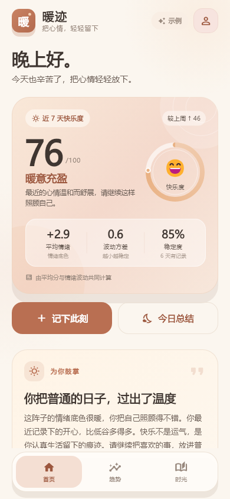
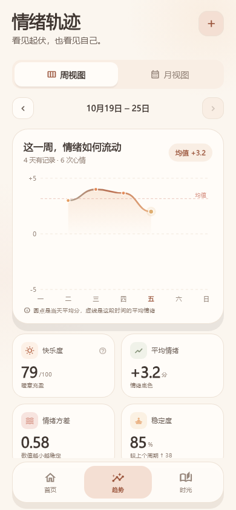
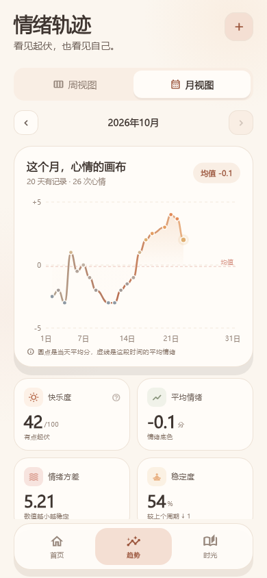
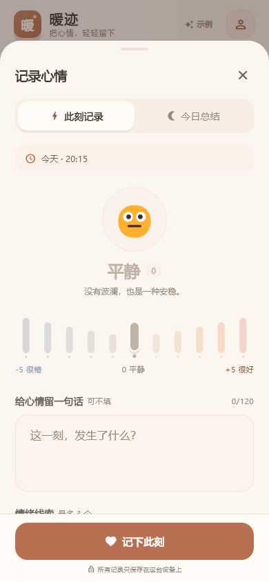
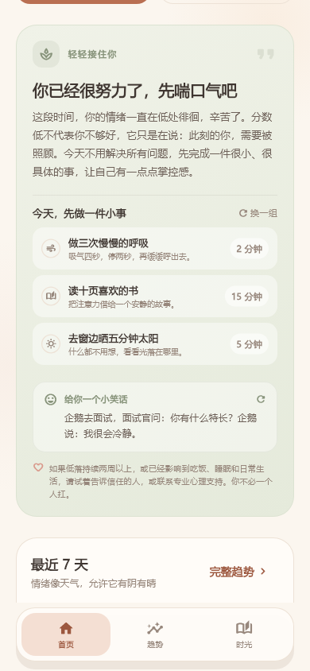

# 暖迹 · 情绪日记

> 把心情轻轻留下。  
> 一款用淡暖色调写成的 Flutter 情绪记录与觉察 App。

暖迹不是要求你「每天开心」的打卡工具。它用 −5 到 +5 的十一个情绪档位，记录此刻的感受与一天的总结；再用平均分、方差与稳定度，把看不见的情绪起伏画成一条可以被温柔看见的曲线。



## 功能

### 1. 两种记录方式

- **记下此刻**：随手记录当下这一刻的心情，可多次记录。
- **今日总结**：回看一整天，留下一个分数、一段文字和情绪线索；同一天只会保留一篇总结，可随时修改。
- **补记**：在「时光」里选择过去的日期补写总结，不让记忆留下空白。
- 每条记录支持 **−5 ～ +5 十一个档位**、最多 120 字心情文字，以及最多 3 个情绪标签。
- 记录保存在本机，不上传服务器。

### 2. 快乐度与情绪指标

每天先按当天所有记录聚合出一个**日平均分**，再基于近 7 天计算：

```text
快乐度 = 50 + 平均情绪 × 10 − 情绪标准差 × 3
```

结果限制在 `0–100`。平均分代表情绪的底色，标准差代表波动；稳定的好心情得分更高，剧烈起伏则会适度扣分。页面里同时呈现：

- 平均情绪（Mean）
- 情绪方差（Variance）
- 情绪标准差（Std. Deviation）
- 稳定度（Stability）
- 与上一周期的快乐度变化

> 快乐度不是心理诊断，只是一面帮助自我觉察的小镜子。

### 3. 可视化

- **周视图**：以周一到周日为窗口，展示每日平均分曲线、均值虚线、高低分布。
- **月视图**：以自然月为窗口，绘制整月情绪曲线，可前后切换月份 / 周。
- **情绪分布**：低处 / 平缓 / 明亮的天数比例。
- **时光日历**：用情绪色点标记每一天，点选日期查看当天时间线与多条记录。
- 图表全部由 `CustomPainter` 手绘，无第三方图表依赖。



<details>
<summary>展开月视图与记录面板</summary>




</details>

### 4. 有回应的主页

主页的反馈不是随机鸡汤，而是依据最近 7 天的情绪状态生成：

| 状态 | 判断依据（摘要） | 反馈方式 |
| --- | --- | --- |
| 持续低落 | 至少 3 天记录、低处占比 ≥ 55%，或快乐度低于 32 | 共情语句 + 3 个可完成的小任务 + 笑话 + 专业支持提示 |
| 明亮 | 平均分 ≥ 1.6、低处很少，或快乐度 ≥ 75 | 鼓励、赞赏 + 把好心情延长的小任务 |
| 稳定 | 平均分为正、标准差 ≤ 1.1 | 肯定稳定感，提醒给自己留白 |
| 起伏 | 其他有记录状态 | 帮助命名情绪，给出温和的自我照顾建议 |

低落状态下会从任务库中挑选 **打扫房间、种花、阅读、听最喜欢的歌、晒太阳、给朋友发消息、慢慢呼吸** 等具体小事；可以勾选完成、换一组任务，也可以换一个笑话。



### 5. 我的小屋

- 记录天数、心情片段数、连续记录天数。
- 一键复制全部记录为 JSON 备份。
- 清空本机记录。
- 快乐度公式与计算口径说明。
- 首次启动是一个干净的空白日记，不会预填任何虚构记录；旧版本留下的示例数据在升级后会自动清除。

## 界面设计

- **底色**：奶油米白 `#FBF6EF`，减少纯白带来的冷感。
- **主色**：陶土橘 `#B96F52`，搭配杏桃 `#E9B183` 与鼠尾草绿 `#87937A`。
- **低情绪色**：灰蓝而非黑色，避免把「低落」视觉上污名化。
- **形态**：24–30px 大圆角、细描边、低对比阴影，信息块像纸张一样轻轻叠放。
- **字体层级**：大号情绪分数作为视觉锚点，正文 12–13px、1.6–1.8 行高，保证长段反馈可读。
- **动效**：分数环形动画、情绪切换缩放淡入、图表绘制进度、任务勾选反馈；均使用系统轻触觉反馈。
- **文案**：避免「战胜负能量」「必须积极」等压力语言，强调「允许、接住、慢慢来」。

## 技术结构

```text
lib/
├─ main.dart                    # 启动、主题、中文本地化
├─ core/
│  ├─ app_theme.dart            # 淡暖色主题、排版、组件样式
│  └─ date_utils.dart           # 日期、周/月、中文时间文案
├─ models/
│  ├─ mood.dart                 # 11 档情绪与标签
│  ├─ emotion_entry.dart        # 记录模型 / JSON 序列化
│  └─ care_task.dart            # 自我照顾任务库
├─ services/
│  ├─ emotion_store.dart        # ChangeNotifier 状态、增删改、连续记录
│  ├─ emotion_storage.dart      # SharedPreferences 本地存储
│  ├─ mood_analytics.dart       # 日聚合、均值、方差、快乐度
│  ├─ insight_engine.dart       # 状态判断、反馈语句、任务、笑话
├─ screens/
│  ├─ root_shell.dart           # 三 Tab 与记录入口
│  ├─ home_screen.dart          # 快乐度、反馈、任务、7 日概览
│  ├─ stats_screen.dart         # 周/月趋势与指标
│  ├─ history_screen.dart       # 日历与时间线
│  ├─ record_sheet.dart         # 此刻 / 今日总结记录面板
│  └─ profile_screen.dart       # 数据与隐私
└─ widgets/
   ├─ charts.dart               # 环形分数、周柱状图、折线图、分布条
   ├─ mood_scale.dart           # 11 档情绪选择器
   └─ common.dart               # 卡片、Pill、空状态等
```

### 数据流

```text
记录 → EmotionStore → SharedPreferences
                    ↓
          MoodAnalytics（按日聚合、均值和方差）
                    ↓
           InsightEngine（状态与反馈）
                    ↓
         Home / Stats / History 重建
```

## 运行

```bash
flutter pub get
flutter run
```

环境：Flutter `3.41.4` / Dart `3.11.1`（`sdk: ^3.11.1`）。主要依赖只有 `shared_preferences` 与 Flutter 官方本地化包。

构建 Web 版并本地预览：

```bash
flutter build web
python -m http.server 8765 --directory build/web
```

然后打开 `http://127.0.0.1:8765`。

已打包的 Web 构建在 `release/warmtrace-web.zip`，解压后用任意静态文件服务器托管 `index.html` 即可。

构建 Android 安装包（需已安装 Android SDK / NDK）：

```bash
flutter build apk --release
```

产物位于 `build/app/outputs/flutter-apk/`。

> 如果项目放在含中文字符的路径下，Android 构建需要 `android/gradle.properties` 中的 `android.overridePathCheck=true`（仓库已配置）。当前开发机未安装 Android NDK，因此本次交付以 Web 构建与源码为主。

## 测试

```bash
flutter analyze
flutter test
```

测试覆盖：

- 均值 / 方差 / 快乐度公式；
- 多条记录按日聚合；
- 持续低落与明亮状态识别；
- 首页渲染、记录保存、底部导航。

## 隐私

所有数据仅写入设备本地 `SharedPreferences`。应用没有账号体系、网络请求和埋点。

如果情绪低落持续两周以上，或已经影响进食、睡眠和日常生活，请尝试告诉信任的人，或寻求专业心理支持。暖迹不能替代心理咨询或医疗诊断。

---


